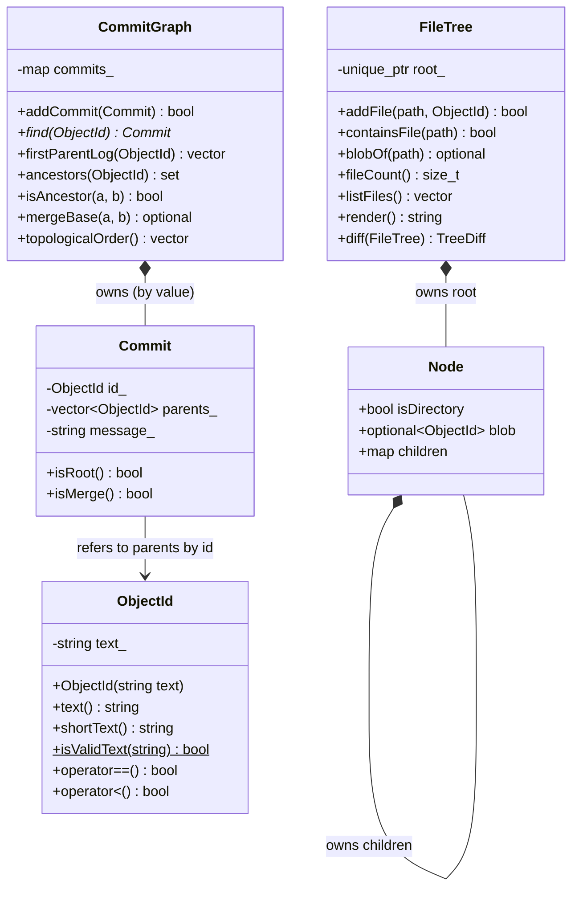

# MiniGit Graph and Tree: Designing Our Own Classes

So far MiniGit mostly *used* standard-library classes. This module is about *designing and implementing our own*. Git's core is two data structures, and we build both:

| Git idea | Data structure | MiniGit class | Real Git command |
|---|---|---|---|
| History | directed acyclic **graph** of commits | `CommitGraph` (+ `Commit`) | `git log --graph`, `git merge-base` |
| Snapshot of files | **tree** of directories and files | `FileTree` | `git ls-tree -r`, `git diff --name-status` |
| Names of things | value type | `ObjectId` | the 40-character hashes |

Everything is in memory; nothing here reads or writes the disk. That keeps the focus on class design and algorithms.

## The classes



| Class | Provided or Issue | What to learn from it |
|---|---|---|
| `ObjectId` | **provided** | value class, constructor enforces an invariant, operators for map keys |
| `Commit` | **provided** | immutable data class, getters only, refers to other objects by id |
| `CommitGraph` | Issues G1–G5 | a class that owns a collection and protects an invariant; BFS |
| `FileTree` | Issues G6–G9 | recursive structure, ownership with `std::unique_ptr`, DFS/recursion |

## The commit graph

```text
       a1 <- b2 <- c3 <------- e5        (main)
               \              /
                `--- d4 <----'           (feature, merged by e5)
```

- An arrow points from a commit to its **parent** (from newer to older).
- `a1` is a **root** commit (no parents). `e5` is a **merge** commit with parents `{c3, d4}`; `c3` is its *first* parent because `main` was checked out during the merge.
- **Invariant:** every parent of a stored commit is also stored. `addCommit` enforces it by rejecting commits whose parents are missing. A nice consequence: a cycle can never be created, because a commit's parents must already exist before it does.

You can see the same shape in any real repository:

```powershell
git log --oneline --graph --all
```

### Algorithms

| Method | Algorithm | Container |
|---|---|---|
| `firstParentLog` | follow `parents()[0]` until a root | loop with `const Commit*` |
| `ancestors` | breadth-first search (BFS) over all parents | `std::queue` + `std::set` (visited) |
| `isAncestor` | membership test in `ancestors` | `std::set::count` |
| `mergeBase` | ancestors of `a`, then BFS from `b`; first hit wins | `std::set`, `std::queue` |
| `topologicalOrder` (stretch) | Kahn's algorithm: repeatedly output a commit with no remaining children | `std::map<ObjectId,int>`, `std::set` |

BFS template you will reuse:

```cpp
std::set<ObjectId> visited{start};
std::queue<ObjectId> toVisit;
toVisit.push(start);
while (!toVisit.empty()) {
    ObjectId current = toVisit.front();
    toVisit.pop();
    // ... look at current ...
    for (const ObjectId& parent : find(current)->parents()) {
        if (visited.insert(parent).second) { // true only the first time
            toVisit.push(parent);
        }
    }
}
```

## The file tree

```text
.
|-- README.md
`-- src
    |-- main.cpp
    `-- util
        `-- math.cpp
```

- Directories are internal nodes; files are leaves that store the `ObjectId` of their contents (Git calls this a **blob**).
- Each `Node` owns its children through `std::unique_ptr<Node>`. When a `FileTree` is destroyed, the whole tree is freed automatically — no `delete` anywhere.
- `unique_ptr` cannot be copied, so `FileTree` is **move-only**. This is deliberate: copying a tree should be an explicit decision, not an accident.
- Children are in a `std::map<std::string, ...>`, so iterating them is automatically in name order. That makes `listFiles()` and `render()` deterministic, which makes them testable.

### Algorithms

| Method | Algorithm |
|---|---|
| `addFile` | iterate the path's parts; walk down, creating missing directory nodes |
| `containsFile`, `blobOf` | iterate the path's parts; walk down; stop at the first missing part |
| `fileCount` | recursion: a file counts 1, a directory is the sum of its children |
| `listFiles` | depth-first preorder, building `"dir/sub/file"` strings |
| `render` | depth-first, passing the indentation string down one level at a time |
| `diff` | compare the two file lists and blob ids |

## Class design checklist (use it when reviewing PRs)

- **One responsibility.** Can you describe the class in one sentence without "and"?
- **Invariant.** What is always true about an object of this class? Which member function protects it?
- **Private data.** Are all data members private? Can a caller break the invariant?
- **`const` correctness.** Do functions that only read have `const` at the end? Do they return `const` references or `const` pointers?
- **Ownership.** Who deletes each object? (Answer should be "a `std::map`/`std::vector` value" or "a `std::unique_ptr`" — never "nobody" or "I call `delete`".)
- **Failure.** How does each function report failure: `bool`, `std::optional`, empty container, or an exception? Is that choice documented in the header?
- **Testability.** Is the output deterministic (sorted, or in a documented order)?

## Issue sequence

Graph and tree issues are independent of each other, so a team of four can split the first rounds: two students on G1→G2→G3→G4, two on G6→G7→G8→G9, and then review each other's PRs.

| Issue | Draft | Depends on |
|---|---|---|
| G1 add / find commits | `10-graph-add-find.md` | — |
| G2 first-parent log | `11-graph-first-parent-log.md` | G1 |
| G3 ancestors (BFS) | `12-graph-ancestors.md` | G1 |
| G4 merge base | `13-graph-merge-base.md` | G3 |
| G5 topological order (stretch) | `14-graph-topo-order.md` | G1 |
| G6 add / look up files | `15-tree-add-lookup.md` | — |
| G7 count and list files | `16-tree-count-list.md` | G6 |
| G8 render as text | `17-tree-render.md` | G6 |
| G9 diff two trees | `18-tree-diff.md` | G7 |

## Ideas for later (not Issues yet)

- `BranchTable`: `std::map<std::string, ObjectId>` from branch name to commit; `HEAD` names a branch (connects to drill S1).
- Give `Commit` a `treeId` so each commit points at a `FileTree` snapshot; then `diff` between two commits = `diff` between their trees.
- `renderGraph()` that prints the history like `git log --graph --oneline`.
- Save and load a `FileTree` with the Week 1 file helpers.
